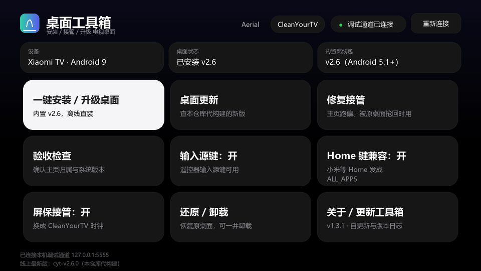

# 桌面工具箱 AerialToolbox

> 🌐 项目主页 / Homepage: **https://mmaotv.github.io/AerialToolbox/**

**给电视 / 电视盒子安装开源桌面（Aerial、CleanYourTV）并接管主页键的一站式工具。**
不需要电脑、不需要 root、不需要拆机 —— 装到电视上，剩下的它自己用电视本机的调试通道完成；
也可以装到**手机**上，用手机远程连接电视完成同样的事。

> English: Install open-source TV launchers (Aerial / CleanYourTV) on Android TV boxes and take over
> the HOME button — no PC, no root. Ships as **two apps**: a TV-side app that runs on the box itself,
> and a **phone-side app** that connects to the box over network ADB (IP input + LAN scan, remote
> control, screenshots).

<p align="center">
  
</p>

<p align="center">
  <sub>Aerial 模式：一屏放下安装、更新、修复、验收与各开关。</sub>
</p>

<p align="center">
  
</p>

<p align="center">
  <sub>CleanYourTV 模式：同一套布局，宫格换成遥控器按键与 Home 键兼容。
  两张都是按 <code>activity_main.xml</code> 的 dp 数值 1:1 还原的版式示意（<code>tools/make_preview.py</code>），不是运行截图。</sub>
</p>

<p align="left">


<a href="../../actions/workflows/android.yml"></a>
</p>

## 这是一个仓库、两个应用

两个应用**共用同一套核心逻辑**（`core` 模块），所以在电视上装出来的结果和在手机上远程装出来的一致。

|  | 电视端 `app` | 手机端 `phone` |
|---|---|---|
| 装在哪 | 电视 / 盒子本机 | 你的手机 |
| 怎么连 | 连**自己**的 adbd（`127.0.0.1:5555`） | 连**电视的** IP（网络 ADB，默认 5555） |
| 安装包 | 已经在电视上，内置离线包直接装 | 在手机上，先 **push** 到电视再装 |
| 适合 | 装完就不用管了，一劳永逸 | 手上没电脑、想远程操作/看状态 |
| 包名 | `com.miaomiaotv.aerial` | `com.miaomiaotv.aerial.phone` |
| 下载 | `AerialToolbox-<版本>.apk` | `AerialToolbox-Phone-<版本>.apk` |

**两个上游桌面**（可切换，一次只接管一个）：

| 上游 | 桌面长什么样 | 我们怎么装 |
|---|---|---|
| [Aerial](https://github.com/pengchujin/aerial-tv) | tvOS 风格，航拍屏保，无障碍守护 | 官方 Release 直接内置，离线可装 |
| [CleanYourTV](https://github.com/Gathin23/cleanyourtv) | Apple TV 风格，dock + 玻璃高光，遥控器按键服务 | **上游只发源码**，由本仓库代构建并降到 Android 5.1 |

界面、图标与字体都按 Aerial 自己的设计语言做（同一个品牌渐变、同一套 tvOS 配色、同一份 Inter 字体），
在电视应用列表里它和 Aerial 是同一个体系的东西。

## 它解决什么问题

Aerial 官方安装说明要求你在电脑上敲一大串 `adb shell` 命令：装包、授权、设默认桌面、
写无障碍守护、接管系统屏保、验收……中间任何一步顺序错了，装得上但主页键回不去。

这个工具把那一整套指令固化进 APK 里。除了处理上游那套流程，它还专门解决了一批真实痛点：

| 痛点 | 处理方式 |
|---|---|
| 电视连不上 GitHub（很常见） | 官方 Release 安装包**内置在 APK 里**，安装全程不联网 |
| 手边没有电脑 | 装**手机端**，填电视 IP 就能远程装 |
| 不知道电视的 IP | 手机端**扫描局域网**，直接列出开了 ADB 的设备 |
| TCL / 雷鸟拒绝 ADB 安装 | 提供 guard 版通道；仍失败时改调系统安装器 |
| 小米待机唤醒后 ADB 被系统关掉 | 「ADB 常开」，由桌面自己把调试开关开回来 |
| 装完按主页键还是回原桌面 | 「修复接管」只重跑授权与接管，不重装 |
| 不知道到底接管成功没有 | 「验收检查」按一次主页键，看前台窗口是不是 Aerial |
| 手机不在电视旁边 | 手机端内置**遥控器**与**截图**，直接操作与查看 |

## 功能

### 电视端（跑在电视上）

顶栏右侧可以切 **Aerial / CleanYourTV**，下面的宫格会跟着换一套语义：两个上游互斥，一次只接管一个桌面。
切到 CleanYourTV 时，「安装通道」换成遥控器按键开关，「ADB 常开」换成「输入源键」与「Home 键兼容」。

| 卡片 | 做什么 |
|---|---|
| **一键安装 / 升级桌面** | 用内置离线包安装 → 授权 → 接管主页键 → 屏保 → 启动确认（Aerial 还要确认守护绑定） |
| **桌面更新** | 进页面才联网：Aerial 查上游 Release，CleanYourTV 查本仓库代构建的 `cyt-v*` 发行版，展示更新日志后再下载 |
| **修复接管** | 不重装，只重跑授权 + 默认桌面 + 守护 / 按键服务（覆盖升级后掉线时用） |
| **验收检查** | Aerial 查 5 项、以「按主页键进入 Aerial」为准；CleanYourTV 查主页归属、原桌面状态、系统版本等 7 项 |
| **安装通道** | 标准版 ⇄ guard 版（guard 不带 HOME 声明，靠无障碍服务接管） |
| **ADB 常开** | 小米等设备待机后 ADB 被关闭时自动打开 |
| **屏保接管** | Aerial 换成航拍屏保；CleanYourTV 换成时钟屏保 |
| **还原 / 卸载** | Aerial 撤销授权与设置；CleanYourTV **重新启用原桌面并把主页还回去**，可一并卸载 |
| **关于 / 更新工具箱** | 本工具的版本与本版本更新日志；查自己的 Release 并就地自更新 |

### 手机端（跑在手机上，远程操作电视）

| 页 | 做什么 |
|---|---|
| **连接** | 手填 **IP 地址 + 端口**（默认 5555）；或一键**扫描局域网**，列出开着 ADB 的设备；连过的设备存成历史，点一下就连 |
| **主页** | 显示电视型号 / 系统版本 / 当前默认桌面 / 已装版本；切换目标桌面（Aerial / CleanYourTV）；一键安装、还原并卸载、验收、修复接管；全程逐行日志与进度 |
| **遥控器** | 方向键 + 确认 / 主页 / 返回 / 菜单 / 电源，直接当遥控器用 |
| **截图** | 截取电视当前画面，存到手机里 |

> 电视端和手机端的「安装 / 还原 / 验收」走的是**同一套**核心代码，
> 所以手机上远程装出来的结果，和把工具箱装到电视上自己装，完全一样。

## 两个上游，两种安装方式

### Aerial

官方 Release 直接给两个 APK（`aerial-standard` / `aerial-guard`），所以「安装」走内置离线包、
「更新」走上游 `releases/latest`，断网设备也能一直用内置包。

### CleanYourTV

上游 Release 的资产是**空的**，正文写着 *“no binaries: build the launcher with `launcher/build-and-install.sh`”* ——
它只发源码，要求用户在自己电脑上用 JDK 17 + Android SDK 34 编译。电视上的一键安装没法照搬这条路，所以：

1. [`.github/workflows/upstream-cleanyourtv.yml`](.github/workflows/upstream-cleanyourtv.yml) 每四小时查一次上游 tag，
   有新版本就下 tarball、打补丁、编译、发成本仓库的 `cyt-v*` 发行版；
2. 工具箱内置一份 `assets/bundled-cyt/CleanYourTV-2.6.apk`，断网也能装；
3. 「桌面更新」查的是**本仓库**的 `cyt-v*`（`releases/latest` 会拿到工具箱自己，所以按 tag 前缀筛）。

补丁在 [`upstream/cleanyourtv/patch.py`](upstream/cleanyourtv/patch.py)，做的事：

| 改动 | 原因 |
|---|---|
| `minSdk` 26 → **22** | 上游只支持 Android 8.0+，这里降到 5.1 |
| API 23/24/26 调用加版本判断 | `getSystemService(Class)`、`isUserUnlocked`、`TvInputInfo#isHidden`、`forceHasOverlappingRendering`、`Bitmap.Config.HARDWARE`、`getLocales` 等在 5.1 上会抛 `NoSuchMethodError` |
| 关掉 Fonts in XML | `@font/` 是 API 26 的资源类型，5.1 上 `TextView` 读到会抛 `Resources$NotFoundException`；改用同字重的系统字体家族 |
| 打开 core library desugaring | `java.time` / `java.util.function` 在 API 26 才有 |
| 换掉 `List#sort` / `removeIf` / `getOrDefault` / `Files.readAllLines` | 这些是 API 24/26 的库方法，desugar 覆盖不到 |
| 固定签名 keystore | 上游用 `signingConfigs.debug`，而 CI runner 每次的 debug key 都不同，会导致「每个新版都装不上上一版」 |

安装顺序照上游脚本严格来：查 SDK → 探测原桌面（只认 `tvlauncher` / `launcherx` / `leanbacklauncher` / `mitv.tvhome`）→
`pm install -r` → **先启动一次并确认 `Status: ok`** → 授权 → 编译 → `pm disable-user` 原桌面 →
`set-home-activity` → 复查 `resolve-activity`，不对就自动把原桌面还回去。

> Android 7.0 以下没有 `cmd package set-home-activity`，这种情况下只能靠「只剩一个桌面」让系统接管，
> 工具箱会提示你按一次主页键并在弹窗里选「始终」。

## 工作原理

整个工具跑在电视本机，通过 `127.0.0.1:5555` 连接**自己**的 adbd，等价于在电脑上执行
`adb install` 与 `adb shell ...`。ADB 协议（CNXN / AUTH / OPEN / WRTE / CLSE）是自己实现的，
不依赖任何第三方库，也不需要 adb 可执行文件。

手机端是同一套实现，只是把连接目标换成电视的 IP，并且多了一条 `sync:` 通道把安装包推到电视上
（电视的 `pm install` 只能读电视本机的文件）。

首次连接时电视上会弹「允许 USB 调试吗？」，用遥控器选允许即可，密钥保存在应用私有目录，
之后自动复用。设备侧的 adbd 只接受一条主机连接，因此同一应用的多页共用同一通道。

安装包必须先落到 shell 能读的位置再 `pm install`：优先公共「下载」目录，
没有写权限时退到应用外部目录；系统安装器路径则通过自实现的 `ContentProvider` 提供只读句柄。

### 主页键为什么有时会「装完还是回原桌面」

`cmd package set-home-activity` 只改「默认桌面」，**HOME role 会一直空着**。
空 role 时系统并不认为存在默认桌面，一旦应用被卸载或设备重启，按主页键就没反应。
所以本工具在设完默认桌面后还会补 `cmd role add-role-holder`，并复查 `isDefault=true` 才算接管成功；
「还原」时同样会把 role 一起还给原桌面。这个问题在 Android 9 及以下（没有 role 服务）尤其明显。

## 快速开始

### 电视端

1. 到 [Releases](../../releases) 下载 `AerialToolbox-x.y.z.apk`，装到电视（U 盘或你惯用的推送工具）。
2. 打开电视的 ADB 调试：

   | 设备 | 路径 |
   |---|---|
   | 小米 / Redmi | 设置 → 账号与安全 → ADB 调试 |
   | 原生 Android TV / 索尼 | 连按「内部版本号」7 次 → 开发者选项 → USB 调试 |
   | TCL / 雷鸟 | 设置 → 关于 → 本机信息 → 遥控器按 上 下 左 右 → 打开 ADB |
   | 海信 VIDAA | 开发者选项 → USB 调试（部分固件需先开启工厂模式） |

3. 打开工具箱 → 点「重新连接」（电视上确认授权）→ 点「一键安装 / 升级桌面」。
4. 装完点「验收检查」，看到「验收通过：主页键进入 Aerial」即完成。

### 手机端

1. 到 [Releases](../../releases) 下载 `AerialToolbox-Phone-x.y.z.apk`，装到手机。
2. **让电视开网络 ADB**（连过一次 USB 调试的电视可以直接开；或用电脑执行一次 `adb tcpip 5555`）：

   | 设备 | 做法 |
   |---|---|
   | 通用 | 电视连一次电脑 ADB 后执行 `adb tcpip 5555` |
   | 小米 / Redmi | 设置 → 账号与安全 → ADB 调试 → **网络调试**（部分机型才有） |
   | 原生 Android TV | 开发者选项 → USB 调试，打开后按 `adb tcpip 5555` |

3. 手机上打开工具箱 → 「扫描局域网」找到电视，或直接手填电视 IP → 点「连接」，在电视上确认授权。
4. 选好目标桌面 → 「一键安装」→「验收」。

> 手机和电视要在**同一个局域网**。手机端不需要 root，也不需要装任何电脑端工具。

## 兼容性

- `minSdk 21`（Android 5.0），`targetSdk 28`，无 `.so`，32 位老电视与 64 位新电视都能装。
- 手机端同样是 `minSdk 21`，普通 Android 手机即可（不需要 Android TV）。
- 已在小米盒子、小米电视系列验证过指令序列（沿用同一套已上线工具箱的实现）。
- **TCL / 雷鸟**：部分固件报 `INSTALL_FAILED_VERIFICATION_FAILURE`，切 guard 版重试；
  仍失败会自动拉起系统安装器，也可以从电视「下载」目录手动安装。
- **海信 VIDAA**：桌面由固件属性 `persist.vt.use_home_pkg` 决定，工具会记录原值并支持还原。
- 未在全部机型实测，遇到问题请带上「验收检查」的结果和 logcat 提 issue。

## 目录结构

```
.github/workflows/
├── android.yml                CI：电视端 + 手机端 assembleRelease + artifact
└── upstream-cleanyourtv.yml   CI：代构建 CleanYourTV（上游 tag → 补丁 → APK → cyt-v* 发行版）
upstream/cleanyourtv/
├── patch.py                   把上游降到 Android 5.1 的补丁脚本（幂等，可重复跑）
└── debug.keystore             固定签名，内置包与线上包必须同一把 key
docs/                           README 用的示意图（截图 / banner / 图标）
tools/                          图标与示意图生成脚本
core/src/main/                  两端共用的核心（不含任何 UI）
├── assets/bundled/            Aerial 内置离线包（官方 Release 的 standard / guard）
│   └── meta.properties        内置包版本号与日期
├── assets/bundled-cyt/        CleanYourTV 内置包（我们代构建的 Android 5.1 兼容版）
│   └── meta.properties        版本、minSdk 与来源说明
├── assets/fonts/inter.ttf     Inter 可变字体（与 Aerial 同一份）
└── java/com/miaomiaotv/aerial/
    ├── adb/                   自实现的 ADB 协议与密钥（CNXN / AUTH / OPEN / WRTE / sync 推送）
    └── core/
        ├── Target.kt          目标桌面注册表（Aerial / CleanYourTV）与更新源
        ├── AerialSpec.kt      Aerial 的包名、组件、指令模板（对齐上游 install.sh）
        ├── AerialRunner.kt    Aerial 的安装 / 修复 / 验收 / 还原
        ├── CleanTvSpec.kt     CleanYourTV 的包名、组件、指令模板（对齐上游 install.sh）
        ├── CleanTvRunner.kt   CleanYourTV 的安装 / 接管 / 回滚 / 验收 / 还原
        ├── HomeRoles.kt       HOME role 的补齐与归还（主页键失灵的关键）
        ├── BundledRelease.kt  释放内置离线包
        ├── DeviceFiles.kt     设备侧文件大小探测（安装包在设备上，不在本机）
        ├── Outcome.kt         两端共用的结果与验收项类型
        └── RivalTakeover.kt   两个上游之间的接管互斥
app/src/main/                   电视端
├── java/com/miaomiaotv/aerial/
│   ├── apk/ApkProvider.kt     交给系统安装器的只读文件提供者
│   ├── core/ReleaseChecker.kt  上游 Release 查询、镜像兜底、下载
│   ├── core/ToolboxUpdater.kt  本仓库的 Release 查询（工具箱自更新）
│   ├── core/ToolboxInfo.kt     工具箱自己的版本号与本版本更新日志
│   ├── Ui.kt                  字体与状态胶囊（Inter 字重、焦点反白）
│   ├── MainActivity.kt        主界面（安装、接管、开关、还原、关于入口）
│   ├── UpdateActivity.kt      桌面更新页（查版本、看日志、下载安装）
│   └── AboutActivity.kt       关于页（本工具版本、更新日志、自更新）
└── res/                        TV 版 XML 布局（遥控器焦点）与 Aerial 同款配色字号
phone/src/main/                 手机端
├── java/com/miaomiaotv/aerial/phone/
│   ├── Session.kt             连接与会话状态（单例，多页共享）
│   ├── AdbKit.kt              建立网络 ADB 连接、推送内置安装包
│   ├── LanScanner.kt          扫描局域网里开着 5555 的设备
│   ├── DeviceStore.kt         历史设备列表
│   ├── ConnectActivity.kt     连接页（IP 输入 / 扫描 / 历史）
│   ├── DashboardActivity.kt   主页（安装、还原、验收、修复、日志）
│   ├── RemoteActivity.kt      遥控器
│   └── ScreenshotActivity.kt  截取电视屏幕
└── res/                        手机版 XML 布局与配色
```

配色与字号的取值直接对照上游
`app/src/main/java/app/orchard/tv/ui/theme/Theme.kt`：`Background #000000`、
`Fill #2E787880`、`Hairline #1AFFFFFF`、焦点 `#F5F5F7 / #1D1D1F`，
→字号用它的 `LargeTitle 26 / Title 19 / Callout 13 / Caption 11` 四档。

## 构建

需要 JDK 17+ 与 Android SDK（compileSdk 36）。

```bash
# local.properties 里写 sdk.dir=...
./gradlew assembleRelease
# 产物：
#   app/build/outputs/apk/release/app-release.apk      电视端
#   phone/build/outputs/apk/release/phone-release.apk  手机端
```

未配置签名时使用本机调试密钥，产出可直接安装的包。正式发布请换成自己的 keystore。

不想装环境也可以用 CI：[`.github/workflows/android.yml`](.github/workflows/android.yml) 在每次
push / PR 上跑 `assembleRelease`，把 `AerialToolbox-<version>.apk`、`AerialToolbox-Phone-<version>.apk`
与各自的 sha256 作为 artifact 传上去，在 Actions 页面直接下载。它只负责「能编译出包」，不签名发布，也不碰 Release。

## 更新内置离线包

内置包决定「离线安装」的版本，当前内置的是 Aerial **v1.30（2026-10-22）** 与 CleanYourTV **v2.6**。

Aerial（从上游下现成的）：

1. 从 [aerial-tv Releases](https://github.com/pengchujin/aerial-tv/releases) 下载
   `aerial-standard.apk` 与 `aerial-guard.apk`，覆盖 `core/src/main/assets/bundled/`。
2. 改 `core/src/main/assets/bundled/meta.properties` 里的 `version` / `tag` / `publishedAt` / `versionCode`。

CleanYourTV（用我们自己 CI 编出来的那个）：

1. 等 `upstream-cleanyourtv.yml` 跑完，从本仓库 `cyt-v*` 发行版下载 `CleanYourTV-<ver>.apk`，
   覆盖 `core/src/main/assets/bundled-cyt/CleanYourTV-<ver>.apk`（旧文件删掉）。
   注意**别用上游源码自己编**：那样签名不是仓库里那把固定 key，会和已在设备上的版本冲突。
2. 改 `core/src/main/assets/bundled-cyt/meta.properties` 里的 `version` / `tag` / `minSdk`。

然后两边都要做：

3. 改 `app/build.gradle.kts` 里工具箱自己的 `versionCode` / `versionName`。
4. 在 `core/ToolboxInfo.kt` 的 `CHANGELOG` 里补一段本版本说明，「关于」页会直接显示它。
5. 重新构建。Gradle 已配置 `noCompress += "apk"`，内置包原样入库。

版本号别偷懒：工具箱按 `meta.properties` 的版本给安装包命名，版本对不上会出现
「本机比内置包新」的降级提示（工具会自动 `pm install -r -d` 放行，但会先提醒你）。

## 重新生成图标

图标与 banner 是按上游图形参数用脚本画出来的，需要 Pillow 与 numpy：

```bash
python tools/make_icons.py
```

脚本会按上游 `aerial-tv/docs/brand/icon.svg` 的同一条拱弧曲线、同一组渐变，生成 mdpi~xxxhdpi
五档图标、自适应图标前景与电视 banner。要改形状就改脚本里的 `ARC` / `BASE` 坐标。

主界面示意图同样由脚本生成（`tools/make_preview.py`，输出 `docs/screenshot-main.png` 与
`docs/screenshot-cleantv.png` 两张），尺寸按 `activity_main.xml` 的 dp 数值换算，所以改了布局记得同步重跑。

## 版本号

从 1.3.x 起**只加第三位**：1.3.1 → 1.3.2 → 1.3.3，`versionCode` 每次 +1。
只有「再引入一个上游」或整体重构这种量级才动第二位。
手机端是独立的一条线，从 `1.0.0` 起。

## 更新日志

### v1.3.3（2026-10-22）

- 修 **还原 / 卸载后主页键失灵**：`set-home-activity` 只改默认桌面、不给 HOME role，
  应用一卸载系统就判成「没有默认桌面」。现在接管前记下原桌面，
  还原时把 role 一起还回去并复查 `isDefault`
- 修 **小屏宫格裁切**：最后一行卡片被切掉

### v1.3.2（2026-10-22）

真机（Amlogic S905L3A / Android 9）实测后修的一轮：

- 修 **点「我明白了」却执行了弹窗背后的卡片**：弹窗原来是主界面里盖的一层遮罩，只挡画面不挡焦点，
  按确认键会落到背后那张卡上。现在改成独立 `Dialog` 窗口，背景根本收不到按键；进度弹窗期间也关不掉
- 修 **点一个模块却跳到另一个模块**：宫格每次刷新都整个重建，重建后焦点被硬塞给第一张卡片。
  现在按槽位记住原焦点，重建后放回原处；操作进行中 / 弹窗显示时宫格整块不接焦点
- 修 **按确认键操作从零重跑一遍**：遥控器连击与「关弹窗」那一下会二次触发，加了 600 ms 防连击；
  主界面改为 `singleTask`，装完桌面用 `am start` 叫回前台不再重建实例、丢进度
- 修 **Android 9 及以下设不上默认桌面**：这些系统没有 role 服务，`cmd role` 回的是
  「Can't find service: role」，旧代码把它当成成功，后面真正的 `set-home-activity` 从不执行
  —— 表现就是装完按主页键还是回原桌面
- 设默认桌面改为以命令退出码为准，不再靠关键字猜成功
- 「还原」同样受这个问题影响，主页还不回去；现在会在接管前记下原桌面，还原时显式设回去
- 「验收检查」不再把「模拟主页键没反应」判成失败（部分固件忽略注入的 HOME 键），
  改以系统解析到的默认桌面为准
- 去掉底部「已连接本机调试通道 …」那行，顶栏状态胶囊已经说明连接状态

### v1.3.1（2026-10-22）

- 新增第二个上游 **CleanYourTV**：顶栏可切换目标桌面，宫格语义跟着换
- **CleanYourTV 支持 Android 5.1+**：上游 `minSdk` 是 26，补丁降到 22 后由本仓库代构建
  （补丁含 API 兼容、字体降级、core library desugaring 与固定签名）
- 安装会先校验新桌面能否启动，再停用原桌面；主页切不过去自动回滚
- 新增「输入源键」「Home 键兼容」两个无障碍开关（默认关）
- 还原会重新启用原桌面并把主页还回去，可一并卸载
- 新增 `upstream-cleanyourtv.yml`：每四小时查上游 tag，有新版本自动构建并发 `cyt-v*` 发行版
- 关于页版本区同时显示两个上游的内置版本
- 本仓库同时放两种发行版后，「查自己有没有新版」改成扫发行版列表，不会被 `cyt-v*` 顶掉

### v1.3.0（2026-10-22）

- 新增「关于 / 更新工具箱」页（主界面右下角，「还原 / 卸载」右边）：本工具版本、内置桌面版本、
  调试通道状态，以及随包发布的本版本更新日志
- 工具箱可以自己升级自己：查本仓库最新 Release → 展示该版本更新日志 → 下载 →
  ADB `pm install -r`，装完重启；ADB 不可用时交给系统安装器
- 平台版本与更新日志都从包管理器 / `ToolboxInfo.CHANGELOG` 读，界面不会再和安装包对不上
- 主界面宫格补满 9 格（三行三列）；桌面安装、修复、验收、还原的行为没有变化

### v1.2.0（2026-10-22）

- 配色、字号、Inter 字体、图标与 TV banner 全部对齐 Aerial 桌面
- 内置离线包升到 Aerial v1.30（2026-10-22）
- 卡片改为三列，说明文案压到单行

### v1.1.0

- 内置离线包：一键安装不再依赖网络
- 独立的「桌面更新」页：查 GitHub Release、看日志、下载后安装

### 手机端 v1.0.0（2026-10-23）

- 全新 **手机端**：填 IP 或扫描局域网 → 远程连接电视 → 一键安装 / 还原 / 验收 / 修复接管
- 与电视端**共用同一套核心逻辑**（`core` 模块），安装结果完全一致
- 新增 **局域网扫描**：自动列出开着 ADB（5555）的设备
- 新增 **遥控器**（方向键 / 主页 / 返回 / 菜单 / 电源）与 **电视截图**
- ADB 客户端新增 **文件推送**（`sync:` 通道）与 **二进制输出**（`exec:` 通道），
  用来把内置安装包推到电视、把电视画面取回手机

## 常见问题

**Q：手机上能扫到电视，但连不上？**
A：电视要在同一个局域网，且已开启网络 ADB（5555）。部分路由器会隔离设备互访（AP 隔离），
这种情况只能用手机手动输入电视 IP 试试，或改用电视端。

**Q：连接时电视上一直弹「允许 USB 调试」？**
A：手机端第一次连新设备时电视会弹授权框，用遥控器选「允许」。密钥会存在手机里，以后不再弹。

**Q：装完按主页键还是回原来的桌面？**
A：点「修复接管」。多数固件还需要电视上按一次主页键并在弹窗里选「始终」。

**Q：手机端和电视端能同时装吗？**
A：能，它们是两个独立应用，可以都装。但**同一个电视上只能有一个桌面在接管**，
装另一个之前会先解除前一个的接管。

## 免责声明

本工具会修改系统设置（默认桌面、无障碍服务、屏保、部分厂商属性），这些改动都可以通过
「还原 / 卸载」撤销，恢复原桌面的方式也一直保留。请自行评估风险，因使用本工具造成的
设备异常由使用者承担。

## 许可证

[MIT](LICENSE)。内置的 Aerial 安装包来自 [pengchujin/aerial-tv](https://github.com/pengchujin/aerial-tv)（MIT），
CleanYourTV 安装包由 [Gathin23/cleanyourtv](https://github.com/Gathin23/cleanyourtv)（MIT）源码打补丁后构建，
版权均归原作者所有。两个桌面本身与本工具无隶属关系。
