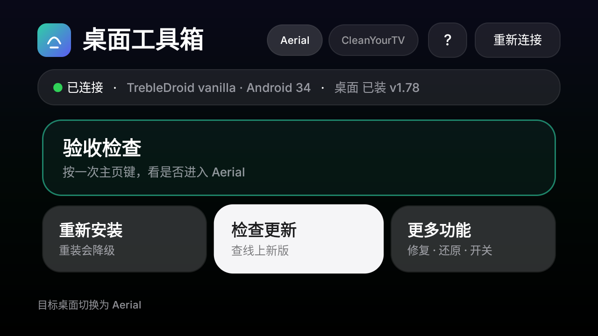
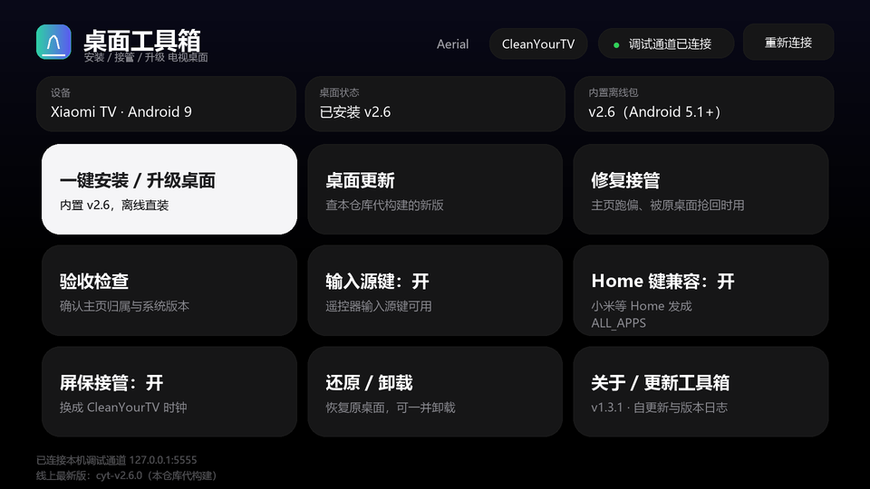

# 桌面工具箱 AerialToolbox

> 🌐 项目主页 / Homepage: **https://mmaotv.github.io/AerialToolbox/**

**给 Android 电视 / 盒子一键安装开源桌面（Aerial、CleanYourTV），并接管主页键。**
不用电脑、不用 root、不用拆机 —— 装到电视上它自己完成，或装到手机上远程帮电视装。

  
  

## 它能做什么

- **两个应用**：电视端（装在盒子上自己装）、手机端（填 IP 或扫局域网远程装），共用一套核心逻辑，装出来的结果一致。
- **两个桌面**：Aerial（tvOS 航拍风）、CleanYourTV（Apple TV dock 风），一次接管一个，可切换。
- **内置离线包**：安装全程不联网，电视连不上 GitHub 也能装。
- **ADB 常开**：小米等盒子待机后 ADB 被关，工具自动把调试开关开回来。
- **修复 / 验收 / 还原**：装完主页键回不去？一键修复接管；一键还原并把主页交还原桌面。

## 下载

到 [Releases](../../releases) 页面，按需要下载：

| 包 | 装在哪 | 文件名 |
|---|---|---|
| 电视端 | 盒子本机 | `AerialToolbox-x.y.z.apk` |
| 手机端 | 你的手机 | `AerialToolbox-Phone-x.y.z.apk` |
| CleanYourTV 桌面（可选） | 想用这个桌面时单独取 | `CleanYourTV-x.y.z.apk` |

- 电视 / 手机端最新版： [`v1.3.4`](https://github.com/mmaotv/AerialToolbox/releases/tag/v1.3.4) · [`phone-v1.0.2`](https://github.com/mmaotv/AerialToolbox/releases/tag/phone-v1.0.2)
- CleanYourTV 桌面： [`cyt-v3.0.0`](https://github.com/mmaotv/AerialToolbox/releases/tag/cyt-v3.0.0)

每个包都附带 `.sha256` 校验文件。

## 第一步：在电视上打开 ADB

**这一步只需要遥控器，不用电脑、不用 USB 线。** 开关打开后，电视自己就在 `5555` 端口监听，后面手机端直接连即可。

| 品牌 / 机型 | 打开路径 |
|---|---|
| **小米 / Redmi 电视、小米盒子** | 设置 → 关于 → **产品型号**（连按确认 7 次）→ 返回 设置 → **账号与安全 → ADB 调试 → 允许** |
| **索尼 BRAVIA、原生 Android TV / Google TV、NVIDIA Shield** | 设置 → 系统（老机型在「设备偏好设置」）→ 关于 → 连按 **版本号 / Android TV OS 版本** 7 次 → 开发者选项 → **USB 调试**（有些固件叫「网络调试」） |
| **TCL / 雷鸟 / 海尔** | 设置 → 关于（本机信息）→ 遥控器依次按 **上 下 左 右**（间隔小于 1 秒）→ 底部出现「更多」→ 打开 ADB |
| **海信（Android TV 系统）** | 设置 → 关于 → **版本号**连按 7 次 → 开发者选项 → USB 调试 |
| **海信（VIDAA 系统）** | 声音设置 → 平衡 → 输入 `0532` 进工厂模式找 ADB（多数机型不开放，装不了就是装不了） |
| **创维 / 酷开** | 本机信息页输 `上上下下左右左右`；或 设置 → 关于电视 → 软件版本号连按 7 次 → 开发者选项 |
| **华为智慧屏** | 设置 → 关于本机 → 版本号连按 7 次 → 系统和更新 → 开发人员选项 → **USB 调试 + 启用 ADB** |
| **长虹** | 菜单 → 情景模式 → 标准模式 → 输入 `0816` |
| **康佳** | 按菜单键 → 输入 `2008` 进工厂菜单 |
| **乐视** | 信号源 → 输入 `2580` → 其他选项 → ADB 调试 → 重启电视 |
| **天猫魔盒 / 当贝 / 外贸盒子（HK1、X96、Mecool 等）** | 设置 → 关于（系统信息）连按 7 次 → 开发者选项 → USB 调试；外贸盒子多为原生 Android TV 通用路径 |

**表里没有你的品牌？** Android TV 通用三步：`设置 → 关于 → 版本号连按 7 次` → 回设置进「开发者选项」→ 打开「USB 调试 / ADB 调试」。国产 OTT 盒子常在「本机信息」页按方向键或输密码弹隐藏菜单。

三条要注意：

- **小米系重启 / 待机后会把 ADB 开关自动关掉**，表现就是"昨天还能连，今天连不上"。本工具的「ADB 常开」就是干这个的——首次经本工具授权后，开机 / 亮屏会自动把开关写回来。
- **Android TV 13 及以上**的部分新机把网络调试改成了「无线调试（配对码）」，端口随机、不再直接连 5555。本工具目前只支持 5555，这类机型请在开发者选项里找「网络调试 / ADB over network」并确认端口是 5555。
- 各品牌隐藏入口随固件版本变动，以上路径以实机为准。

## 第二步：选一种安装方式

### 方式 A · 电视端（装在电视上自己装）

1. 下载 `AerialToolbox-*.apk` 装到电视（U 盘拷过去用电视的文件管理器打开即可）。
2. 打开工具箱 →「重新连接」→ 电视弹出授权框，遥控器选「允许」。
3. 点「一键安装桌面」→ 装完点「验收检查」，通过即完成。

### 方式 B · 手机端远程装（同样不需要电脑）

**电视只要开了 ADB，手机上输入 IP 就能连，全程不用电脑、不用 USB 线。**

1. 下载 `AerialToolbox-Phone-*.apk` 装到手机。
2. 让手机和电视连**同一个 Wi-Fi / 路由器**。
3. 在电视上查 IP：设置 → 关于 → **网络信息 → IPv4 地址**（品牌间略有差异，记下 `192.168.x.x`）。
4. 手机打开工具箱 → 点「扫描局域网」自动发现，或手填电视 IP（端口默认 `5555`）→ 连接 → 电视弹出授权框，选「允许」。
5. 选桌面 → 安装 → 验收检查。手机端还自带遥控器和截图。

> **为什么不用连电脑？** Android 的 `adbd` 是设备内部常驻的调试服务，电视一打开 ADB，它自己就在 `5555` 上监听。手机端只是在扮演"另一台 adb 客户端"，所以跳过电脑直连完全可行——不需要 `adb tcpip 5555`，也不需要 USB 线。
>
> 极少数固件默认只开 USB 调试不开网络调试：去开发者选项里另找「网络调试 / ADB over network」打开，或改用方式 A 在电视本机装。

## 常见问题

**Q：没有电脑，手机上真能装吗？**
A：能。电视开 ADB 后 `5555` 就在监听，手机端直接连，全程不需要电脑和 USB 线。

**Q：装完按主页键还是回原桌面？**
A：点「修复接管」；部分固件还要在电视上按一次主页键、弹窗里选「始终」。

**Q：手机扫到电视但连不上？**
A：确认同一局域网、电视已开 ADB（5555）。路由器开了 AP 隔离会拦设备互访，改手填 IP 或改用电视端。小米盒子先检查 ADB 开关是不是又被系统关掉了。

**Q：连接时一直弹「允许 USB 调试」？**
A：首次连新设备会弹，用遥控器选「允许」并勾「始终允许」，密钥会保存，以后不再弹。

**Q：电视端和手机端能同时装吗？**
A：可以，是两个独立应用；但同一台电视同一时刻只能有一个桌面在接管，装另一个之前会先解除前一个。

## 兼容性

- 支持 Android 5.0+（minSdk 21），32 / 64 位均可，无 `.so`。
- 已在小米盒子 / 小米电视系列验证；TCL / 雷鸟部分固件装不上时切 guard 版，仍失败会自动拉起系统安装器，也可从电视「下载」目录手动装。
- 遇到问题请带「验收检查」结果与 logcat 提 issue。

## 免责声明

本工具会修改系统设置（默认桌面、无障碍服务、屏保、部分厂商属性），都可通过「还原 / 卸载」撤销。请自行评估风险，因使用本工具造成的设备异常由使用者承担。

## 许可证

[MIT](LICENSE)。内置 Aerial 来自 [pengchujin/aerial-tv](https://github.com/pengchujin/aerial-tv)（MIT），CleanYourTV 来自 [Gathin23/cleanyourtv](https://github.com/Gathin23/cleanyourtv)（MIT）源码打补丁后构建，版权均归原作者所有；两个桌面与本工具无隶属关系。
