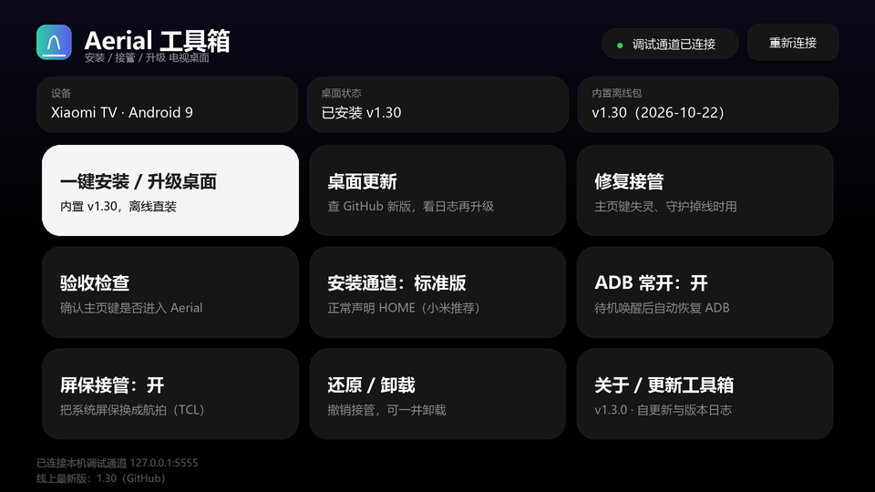
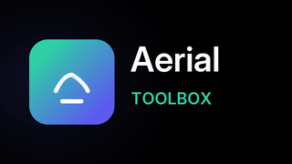

# Aerial 工具箱

给电视 / 电视盒子安装开源桌面 [Aerial](https://github.com/pengchujin/aerial-tv) 并接管主页键的一站式工具。

**不需要电脑、不需要 root、不需要拆机** —— 把它装到电视上，剩下的它自己用电视本机的调试通道完成。

界面、图标与字体都按 Aerial 自己的设计语言做（同一个品牌渐变、同一套 tvOS 配色、同一份 Inter 字体），
在电视应用列表里它和 Aerial 是同一个体系的东西。

<p align="center">
  
</p>

<p align="center">
  <sub>主界面示意图：一屏放下安装、更新、修复、验收与各开关。图为按布局 dp 数值 1:1 还原的版式示意（<code>tools/make_preview.py</code>），不是运行截图。</sub>
</p>

<p align="left">


<a href="../../actions/workflows/android.yml"></a>
</p>

## 它解决什么问题

Aerial 官方安装说明要求你在电脑上敲一大串 `adb shell` 命令：装包、授权、设默认桌面、
写无障碍守护、接管系统屏保、验收……中间任何一步顺序错了，装得上但主页键回不去。

这个工具把那一整套指令固化进 APK 里，在电视本机执行。除此之外还专门处理了几个真实痛点：

| 痛点 | 处理方式 |
|---|---|
| 电视连不上 GitHub（很常见） | 官方 Release 安装包**内置在 APK 里**，安装全程不联网 |
| TCL / 雷鸟拒绝 ADB 安装 | 提供 guard 版通道；仍失败时改调系统安装器 |
| 小米待机唤醒后 ADB 被系统关掉 | 「ADB 常开」，由桌面自己把调试开关开回来 |
| 装完按主页键还是回原桌面 | 「修复接管」只重跑授权与接管，不重装 |
| 不知道到底接管成功没有 | 「验收检查」按一次主页键，看前台窗口是不是 Aerial |

## 功能

| 卡片 | 做什么 |
|---|---|
| **一键安装 / 升级桌面** | 用内置离线包安装 → 授权 → 接管主页键 → 屏保 → 启动并确认守护绑定 |
| **桌面更新** | 进页面才联网查 GitHub 最新 Release，展示更新日志，用户点「下载并安装」后下载并安装 |
| **修复接管** | 不重装，只重跑授权 + 默认桌面 + 守护（覆盖升级后守护掉线时用） |
| **验收检查** | 4 项检查，只有「按主页键进入 Aerial」算真正通过 |
| **安装通道** | 标准版 ⇄ guard 版（guard 不带 HOME 声明，靠无障碍服务接管） |
| **ADB 常开** | 小米等设备待机后 ADB 被关闭时自动打开 |
| **屏保接管** | 把系统屏保换成 Aerial 的航拍屏保（仅使用系统屏保的电视，如 TCL） |
| **还原 / 卸载** | 逐条撤销授权与设置，可只还原，也可连 Aerial 一起卸载 |
| **关于 / 更新工具箱** | 本工具的版本与本版本更新日志；查自己的 Release 并就地自更新 |

## 界面与样式

界面按 Aerial 自己的设计语言做，而不是随便套一个 Material 主题：纯黑背景、半透明 `Fill` 面板、
1px `Hairline` 描边，遥控器移到哪张卡片，哪张就整块反白（`#F5F5F7` 底 + `#1D1D1F` 字），
和 Aerial 里被选中的影片条目是同一种反馈。字形用 Aerial 同一份 Inter 可变字体。

顶栏常显调试通道状态，下面三块分别是设备、桌面状态、内置离线包版本；
所有操作逐行打到最下方的日志行，进度与确认用居中浮层，不跳页、不遮挡卡片。

<p align="center">
  
  &nbsp;&nbsp;&nbsp;
  
</p>

<p align="center">
  <sub>图标与电视 banner 用同一份拱弧曲线、同一组品牌渐变（<code>#2FD0A5 → #5B5BF0</code>），与 Aerial 摆在应用列表里是同一个体系。</sub>
</p>

## 两条路径：安装离线，更新在线

```
                    ┌─────────────────────────────┐
  点「一键安装」  →  │ 内置离线包 assets/bundled/*.apk │ → ADB 安装 → 授权 → 接管
                    └─────────────────────────────┘
                                   ↑ 不需要网络

                    ┌─────────────────────────────┐
  点「桌面更新」  →  │ GitHub API 查最新 Release    │ → 展示更新日志 → 用户点下载
                    └─────────────────────────────┘
                                   ↓
                      GitHub 直链失败自动切官网镜像
                                   ↓
                    ADB 安装（顺带接管）／系统安装器
```

「桌面更新」页打开时会自动检查一次，之后不主动联网。断网设备可以一直只用内置包。

## 工具箱自己怎么升级

桌面和工具是两条互不影响的更新线：

| | 更新对象 | 入口 | 装完还要接管吗 |
|---|---|---|---|
| 桌面 | Aerial（`app.orchard.tv`） | 主界面「桌面更新」 | 要：授权 + 主页键 + 屏保 |
| 工具箱 | 本工具自己 | 主界面「关于 / 更新工具箱」 | 不用，装上即完成 |

「关于」页进来先摆**本版本的更新日志**（随 APK 一起发布，离线可看），随后自动查一次本仓库的
最新 Release：查到新版就把日志区换成线上版本的说明，按钮变成「升级到 x.y.z」，点了才开始下载。
按钮文案与版本号都是从包管理器里读的，不会出现「界面写 1.3.0、实际装的是别的」这种事。

自更新走 ADB `pm install -r`，**安装的一瞬间系统会关掉工具箱**（等价于换包重启），属正常现象，
所以下载完会先弹确认框讲清楚；ADB 不可用时退回系统安装器。桌面那边的接管状态完全不受影响。

> 签名提醒：自更新要求新旧包用同一把密钥签。Release 里的包与本地构建用的是本机调试密钥；
> CI artifact 用的是 runner 的调试密钥，用 CI 包自更新会报 `INSTALL_FAILED_UPDATE_INCOMPATIBLE`，
> 需要先卸载再装。（装的是 Release 包就不会遇到。）

## 工作原理

整个工具跑在电视本机，通过 `127.0.0.1:5555` 连接**自己**的 adbd，等价于在电脑上执行
`adb install` 与 `adb shell ...`。ADB 协议（CNXN / AUTH / OPEN / WRTE / CLSE）是自己实现的，
不依赖任何第三方库，也不需要 adb 可执行文件。

首次连接时电视上会弹「允许 USB 调试吗？」，用遥控器选允许即可，密钥保存在应用私有目录，
之后自动复用。设备侧的 adbd 只接受一条主机连接，因此主界面与更新页共用同一通道（`core/AdbSession`）。

安装包必须先落到 shell 能读的位置再 `pm install`：优先公共「下载」目录，
没有写权限时退到应用外部目录；系统安装器路径则通过自实现的 `ContentProvider` 提供只读句柄。

## 快速开始

1. 到 [Releases](../../releases) 下载 `AerialToolbox-x.y.z.apk`，装到电视（U 盘或你惯用的推送工具）。
2. 打开电视的 ADB 调试：

   | 设备 | 路径 |
   |---|---|
   | 小米 / Redmi | 设置 → 账号与安全 → ADB 调试 |
   | 原生 Android TV / 索尼 | 连按「内部版本号」7 次 → 开发者选项 → USB 调试 |
   | TCL / 雷鸟 | 设置 → 关于 → 本机信息 → 遥控器按 上 下 左 右 → 打开 ADB |
   | 海信 VIDAA | 开发者选项 → USB 调试（部分固件需先开启工厂模式） |

3. 打开工具箱 → 点「重新连接」（电视上确认授权）→ 点「一键安装 / 升级桌面」。
4. 装完点「验收检查」，看到「验收通过：主页键进入 Aerial」即完成。

## 兼容性

- `minSdk 21`（Android 5.0），`targetSdk 28`，无 `.so`，32 位老电视与 64 位新电视都能装。
- 已在小米盒子、小米电视系列验证过指令序列（沿用同一套已上线工具箱的实现）。
- **TCL / 雷鸟**：部分固件报 `INSTALL_FAILED_VERIFICATION_FAILURE`，切 guard 版重试；
  仍失败会自动拉起系统安装器，也可以从电视「下载」目录手动安装。
- **海信 VIDAA**：桌面由固件属性 `persist.vt.use_home_pkg` 决定，工具会记录原值并支持还原。
- 未在全部机型实测，遇到问题请带上「验收检查」的结果和 logcat 提 issue。

## 目录结构

```
.github/workflows/android.yml   CI：assembleRelease + artifact
docs/                           README 用的示意图（截图 / banner / 图标）
tools/                          图标与示意图生成脚本
app/src/main/
├── assets/bundled/            内置离线包（官方 Release 的 standard / guard 两个 APK）
│   └── meta.properties        内置包版本号与日期
├── assets/fonts/inter.ttf     Inter 可变字体（与 Aerial 同一份）
├── java/com/miaomiaotv/aerial/
│   ├── adb/                   自实现的 ADB 协议与密钥（CNXN / AUTH / OPEN / WRTE）
│   ├── apk/ApkProvider.kt     交给系统安装器的只读文件提供者
│   ├── core/
│   │   ├── AerialSpec.kt      包名、组件、指令模板（对齐上游 tools/install.sh）
│   │   ├── AerialRunner.kt    安装 / 修复 / 验收 / 还原
│   │   ├── BundledRelease.kt  释放内置离线包
│   │   ├── ReleaseChecker.kt  Aerial 的 Release 查询、镜像兜底、下载
│   │   ├── ToolboxUpdater.kt  本仓库的 Release 查询（工具箱自更新）
│   │   ├── ToolboxInfo.kt     工具箱自己的版本号与本版本更新日志
│   │   ├── Changelog.kt       Release 正文（markdown）的轻量清洗，两页共用
│   │   └── AdbSession.kt      全局唯一调试通道
│   ├── Ui.kt                  字体与状态胶囊（Inter 字重、焦点反白）
│   ├── MainActivity.kt        主界面（安装、接管、开关、还原、关于入口）
│   ├── UpdateActivity.kt      桌面更新页（查版本、看日志、下载安装）
│   └── AboutActivity.kt       关于页（本工具版本、更新日志、自更新）
└── res/
    ├── layout/                TV 版 XML 布局（遥控器焦点）
    ├── color/                 焦点态文字色 selector（跟随卡片焦点）
    ├── values/                配色（对照上游 Palette）、字号刻度、按钮样式
    ├── drawable*/             面板 / 卡片 / 按钮（焦点反白）、品牌标、TV banner
    └── mipmap-*/              各密度图标 + API 26 自适应图标
```

配色与字号的取值直接对照上游
`app/src/main/java/app/orchard/tv/ui/theme/Theme.kt`：`Background #000000`、
`Fill #2E787880`、`Hairline #1AFFFFFF`、焦点 `#F5F5F7 / #1D1D1F`，
字号用它的 `LargeTitle 26 / Title 19 / Callout 13 / Caption 11` 四档。

## 构建

需要 JDK 17+ 与 Android SDK（compileSdk 36）。

```bash
# local.properties 里写 sdk.dir=...
./gradlew assembleRelease
# 产物：app/build/outputs/apk/release/app-release.apk
```

未配置签名时使用本机调试密钥，产出可直接安装的包。正式发布请换成自己的 keystore。

不想装环境也可以用 CI：[`.github/workflows/android.yml`](.github/workflows/android.yml) 在每次
push / PR 上跑 `assembleRelease`，把 `AerialToolbox-<version>.apk` 与 sha256 作为 artifact 传上去，
在 Actions 页面直接下载。它只负责「能编译出包」，不签名发布，也不碰 Release。

## 更新内置离线包

内置包决定「离线安装」的版本，当前内置的是 **v1.30（2026-10-22）**。升级步骤如下：

1. 从 [aerial-tv Releases](https://github.com/pengchujin/aerial-tv/releases) 下载
   `aerial-standard.apk` 与 `aerial-guard.apk`，覆盖 `app/src/main/assets/bundled/`。
2. 改 `app/src/main/assets/bundled/meta.properties` 里的 `version` / `tag` / `publishedAt` / `versionCode`。
3. 改 `app/build.gradle.kts` 里工具箱自己的 `versionCode` / `versionName`。
4. 在 `core/ToolboxInfo.kt` 的 `CHANGELOG` 里补一段本版本说明，「关于」页会直接显示它。
5. 重新构建。Gradle 已配置 `noCompress += "apk"`，内置包原样入库。

版本号别偷懒：工具箱按 `meta.properties` 的版本给安装包命名，版本对不上会出现
「本机比内置包新」的降级提示（工具会自动 `pm install -r -d` 放行，但会先提醒你）。

## 重新生成图标

图标与 banner 是按上游图形参数用脚本画出来的，需要 Pillow 与 numpy：

```bash
python tools/make_icons.py
```

脚本会按上游 `aerial-tv/docs/brand/icon.svg` 的同一条拱弧曲线、同一组渐变，生成 mdpi~xxxhdpi
五档图标、自适应图标前景与电视 banner。要改形状就改脚本里的 `ARC` / `BASE` 坐标。

主界面示意图同样由脚本生成（`tools/make_preview.py`，输出 `docs/screenshot-main.png`），
尺寸按 `activity_main.xml` 的 dp 数值换算，所以改了布局记得同步重跑。

## 更新日志

### v1.3.0（2026-10-22）

- 新增「关于 / 更新工具箱」页（主界面右下角，「还原 / 卸载」右边）：本工具版本、内置桌面版本、
  调试通道状态，以及随包发布的本版本更新日志
- 工具箱可以自己升级自己：查本仓库最新 Release → 展示该版本更新日志 → 下载 →
  ADB `pm install -r`，装完重启；ADB 不可用时交给系统安装器
- 平台版本与更新日志都从包管理器 / `ToolboxInfo.CHANGELOG` 读，界面不会再和安装包对不上
- 主界面宫格补满 9 格（三行三列）；桌面安装、修复、验收、还原的行为没有变化

### v1.2.0（2026-10-22）

- 配色、字号、Inter 字体、图标与 TV banner 全部对齐 Aerial 桌面
- 内置离线包升到 Aerial v1.30（2026-10-22）
- 卡片改为三列，说明文案压到单行

### v1.1.0

- 内置离线包：一键安装不再依赖网络
- 独立的「桌面更新」页：查 GitHub Release、看日志、下载后安装

## 免责声明

本工具会修改系统设置（默认桌面、无障碍服务、屏保、部分厂商属性），这些改动都可以通过
「还原 / 卸载」撤销，恢复原桌面的方式也一直保留。请自行评估风险，因使用本工具造成的
设备异常由使用者承担。

## 许可证

[MIT](LICENSE)。内置的 Aerial 安装包来自 [pengchujin/aerial-tv](https://github.com/pengchujin/aerial-tv)（MIT），
版权归原作者所有。Aerial 桌面本身与本工具无隶属关系。
